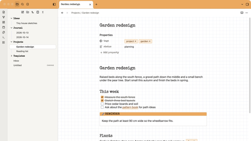

# Bloc

A light Obsidian theme modeled on the classic orange-covered French graph pad: an orange binding across the top with a tear-off perforation, extra-white paper, and a pale blue grid your text sits on.



## Features

- **Graph paper that lines up with your text.** In editing view the ruling is anchored to your first line of text, so every line sits on the paper like handwriting.
- **Four papers.** Grid by default, plus lined, dots and blank, chosen per note.
- **Orange binding.** The top bar is the pad's cover color, with bold black labels and a dotted tear line.
- **Typewriter headings.** Special Elite for titles, headings, callout labels and property names; your system font for everything else. The whole theme is under 100 KB.
- **Notebook details.** Callouts as white cards with a colored label strip, tags like small stamps, orange checkboxes, and the active note lifted off the stack like a sheet.
- **Light only.** Dark mode shows the same paper.

## Install

**From Obsidian:** Settings → Appearance → Themes → Manage, search for **Bloc**, then select **Install and use**.

**Manually:** download `theme.css` and `manifest.json` from the [latest release](../../releases/latest) and put them in a folder named `Bloc` inside your vault's `.obsidian/themes` folder. Then pick Bloc under Settings → Appearance → Themes.

Requires Obsidian 1.14 or later.

## Change the paper for one note

Every note is graph paper. To change a single note, add a `cssclasses` property:

```yaml
---
cssclasses: lined
---
```

| Value | Paper |
|---|---|
| `lined` | Ruled lines |
| `dots` | Dot grid |
| `blank` | Plain paper |
| `roomy` | Text on every second square (combine it, e.g. `[lined, roomy]`) |

**Tip:** make one tiny template per paper (a note containing only that property) and use **Templates: Insert template** from the command palette. Give each template a hotkey and you can switch paper with one keystroke.

## Options

Install the [Style Settings](https://github.com/mgmeyers/obsidian-style-settings) plugin to change Bloc's defaults under Settings → Style Settings → Bloc.

| Option | Choices |
|---|---|
| Square size | 12 to 28px (19 to 20px is close to 5 mm) |
| Roomier text | Text on every second square, for all notes |
| Ruling color and strength | Any color, 10 to 100% |
| Cover color | Any color. Keep it light, since it sits behind black text. |
| Top band height | 40 to 72px |
| Tear line | On or off |

## Known limits

- Text after a callout, embed or image can sit slightly off the lines, because those blocks have their own heights.
- Reading view shows the grid as page texture without exact line alignment.
- Bloc is a light theme: dark mode uses the same paper.

## License

Bloc is released under the [MIT License](LICENSE). The bundled Special Elite font by Astigmatic is licensed under the Apache License 2.0. See [FONT-LICENSE.txt](FONT-LICENSE.txt).

Bloc is an independent project and is not affiliated with any notebook or stationery brand.
